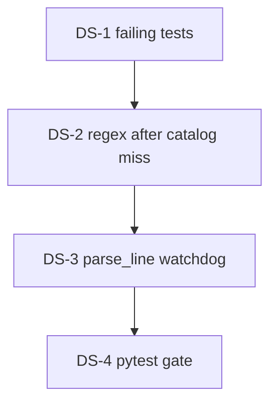

# Plan: Точка между длиной с запятой и шириной

**Created:** 2026-10-13  
**Status:** IMPLEMENT done 2026-10-13  
**Spec:** [`ai_docs/specs/plate-decimal-dot-separator.md`](../../specs/plate-decimal-dot-separator.md)  
**Связано:** [`ai_docs/specs/plate-mark-normalizer-integrity.md`](../../specs/plate-mark-normalizer-integrity.md) — `ПБ 47.5-12-8п` и каталог `L.W` не меняют смысл.

## Goal

После отказа каталога одна точка между длиной с запятой и шириной (`ПБ 35,3.10,2-8 44`) становится дефисом (`ПБ 35,3-10,2-8 44`). Семь строк инцидента разбираются `parse_line`. Каталог и десятичная длина через точку не переписываются.

## Current state

| Компонент | Сейчас |
|-----------|--------|
| `parse_catalog_mark` | `(\d+)\.(\d{1,2})` — длина с запятой не каталог, `None` |
| `canonicalize_plate_line` | После отказа каталога отдаёт очищенную строку как есть |
| `parse_line` | Жадный `[\d\.,]+` забирает `35,3.10,2` как длину → `dimension_parse_failed` |
| Та же строка с дефисом | Уже 3,53 × 1,02, нагрузка 8, qty 44 |
| Парсер / прайс / мастер | Не трогаем. `_PLATE_MARK_RE` не менять |

## Architecture decisions

1. **Одно правило после каталога (D1–D2).** В `canonicalize_plate_line`, только если `parse_catalog_mark` вернул `None`. Не заменять все точки. Не дописывать `п`.
2. **Паттерн узкий.** `ПБ|ПК`, длина `\d+,\d+`, ровно одна точка, ширина целое или одна запятая, затем дефис нагрузки. `35,3.10.2-8` не матчится. `47.5-12-8п` не матчится (в длине нет запятой).
3. **Канон.** Префикс в верхнем регистре, один пробел после него, без пробелов вокруг дефисов размеров, хвост (количество, `п` уже в нагрузке) как в очищенной строке.
4. **Сторож (D3).** Принять замену, только если `parse_line(канон)` успешен и совпадает с разбором строки, где эта же точка уже дефис (L/W `1e-3` м, нагрузка `1e-6`, qty точно). Иначе откат к очищенной строке, `warn=None`, `logger.debug`.
5. **Warning (D4).** Только принятая замена: `{stripped!r} → {canonical!r}`.
6. **Тесты сначала** в `tests/test_plate_normalizer.py`. Парсер, прайс, мастер, `bot_archived/` не трогать. Дубли не склеивать.



## Implementation order

| Phase | Focus | Depends |
|-------|-------|---------|
| 1 | Красные тесты: канон, «не менять», 7 строк, две точки | — |
| 2 | Замена одной точки + сторож | 1 |
| 3 | Gate `test_plate_normalizer` и парсер, если файл есть | 2 |

Параллелить нечего: один модуль.

## Risks

| Риск | Митигация |
|------|-----------|
| Каталог `59.12` / `56.05` попадёт в новое правило | Правило только после `parse_catalog_mark is None`; в длине обязательна запятая |
| `47.5-12-8п` снова станет `47-5,0` | Нет запятой в длине; регресс-тест без смены ожиданий |
| `35,3.10.2-8` молча перепишется | Ширина не глотает вторую точку; после ширины нужен дефис, не точка |
| Сторож примет кривой канон | Сверка с hyphenated-формой через `parse_line`; иначе откат |
| Пробелы вокруг точки | В паттерне `\s*`; в каноне пробелы вокруг дефисов снимаются |

## Task list

### Phase 1: Tests first

- [x] **DS-101:** Таблица канона `canonicalize_plate_line` (запятая-точка, целая ширина `12`, `п`, `ПК`, слитый `пб`)
  - **Acceptance:** каждая строка таблицы spec → канон с дефисом; warning `{src!r} → {dst!r}`
  - **Verify:** красный до DS-201
  - **Files:** `tests/test_plate_normalizer.py`
  - **Scope:** S

- [x] **DS-102:** Таблица «не менять» + две точки `35,3.10.2-8`
  - **Acceptance:** каталог как сейчас; `47.5` остаётся 4,75 м, `warn is None`; две точки без warning и без переписывания; `1.2x3.39` не марка ПБ
  - **Verify:** зелёный и до, и после фикса (регресс)
  - **Files:** `tests/test_plate_normalizer.py`
  - **Scope:** S
  - **Dependencies:** DS-101

- [x] **DS-103:** Семь строк инцидента через `normalize_order_text` + `parse_line`
  - **Acceptance:** все `parsed`; размеры как в spec; ни одна не `dimension_parse_failed`
  - **Verify:** красный до DS-201
  - **Files:** `tests/test_plate_normalizer.py`
  - **Scope:** S
  - **Dependencies:** DS-101

**Checkpoint 1:** контракт зафиксирован, код старый, канон и инцидент падают.

### Phase 2: Rule + watchdog

- [x] **DS-201:** После отказа каталога — regex одной точки и сборка канона
  - **Acceptance:** DS-101 зелёный; каталожные ожидания не ослаблены
  - **Verify:** `pytest tests/test_plate_normalizer.py -q`
  - **Files:** `core/plate_text_normalizer.py`
  - **Scope:** S
  - **Dependencies:** DS-101

- [x] **DS-202:** Сторож `parse_line` канона vs строка с этой точкой уже как дефис
  - **Acceptance:** mismatch → очищенная строка, `warn is None`, debug; `35,3.10.2-8` не кандидат
  - **Verify:** `pytest tests/test_plate_normalizer.py -q`
  - **Files:** `core/plate_text_normalizer.py`
  - **Scope:** S
  - **Dependencies:** DS-201

**Checkpoint 2:** замена принимается только вместе со сторожем.

### Phase 3: Gate

- [x] **DS-301:** Инцидент DS-103 зелёный; парсер-тесты без регресса
  - **Acceptance:** семь строк дают L/W/load/qty из spec
  - **Verify:**
    ```bash
    pytest tests/test_plate_normalizer.py -q
    pytest tests/test_plate_line_parser.py tests/test_plate_normalizer.py -q
    ```
  - **Files:** только если всплывёт регресс в нормализаторе или его тестах
  - **Scope:** S
  - **Dependencies:** DS-103, DS-202

**Checkpoint 3:** success criteria spec закрыты.

## Out of this plan

- Правка `_PLATE_MARK_RE` и `plate_line_parser.py`
- Склейка дублей
- Мастер, `unparsed_lines` UI, прайс, `bot_archived/`
- Замена всех точек на дефисы или запятые

## DoD

- [x] `ПБ 35,3.10,2-8 44` и остальные шесть строк инцидента → дефис и размеры из spec
- [x] `ПБ 59.12-8Вр1400-25` → `ПБ 59-12-8п`
- [x] `ПБ 47.5-12-8п 2` → 4,75 м, не `47-5,0`
- [x] `ПБ 35,3.10.2-8 44` не переписывается
- [x] `pytest tests/test_plate_normalizer.py -q` зелёный
