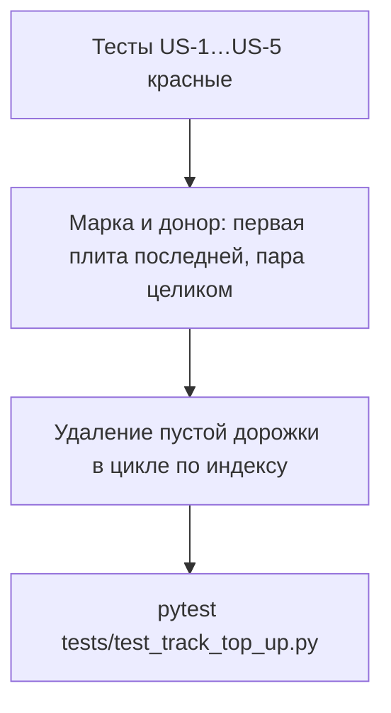

# Plan: Добор более ранних дорожек плитами последней

**Created:** 2026-10-21  
**Status:** код сделан, тесты зелёные (`pytest tests/test_track_top_up.py`: 41 passed). Год пула не запускался. Git commit нет.  
**Spec:** [`ai_docs/specs/razbor-korotkogo-hvosta-dorozhki.md`](../../specs/razbor-korotkogo-hvosta-dorozhki.md)  
**Идея:** [`ai_docs/ideas/razbor-korotkogo-hvosta-dorozhki.md`](../../ideas/razbor-korotkogo-hvosta-dorozhki.md)

## Goal

`top_up_tracks_from_following` закрывает зазор до 101 м плитой со следующей дорожки. Единственная первая плита последней дорожки уезжает. Если все item последней дорожки вместе влезают в зазор и ни один не поднимает проволоку и марку, уезжает весь остаток по порядку: первая плита и продольный рез (`mode split`, с `secondary_cuts` или без). Пустая дорожка исчезает. Хвост, который целиком не влез, не разрывается этим правилом; влезающая непервая плита длинного хвоста уезжает по-старому. Бывшая предпоследняя может остаться короче 101 м. Оптимизатор, нарезка и вызовы функции не меняются.

## Current state

| Компонент | Сейчас |
|-----------|--------|
| `is_eligible_donor` | Отказ при `item_index <= 0`, не `solid`, любом `secondary_cuts`. Марку не смотрит |
| `top_up_tracks_from_following` | Обход `for i, track in enumerate(tracks)`. Доноры `j > i`. После `pop` пустую дорожку не удаляет |
| Вызовы | `planning.py` при флаге; отчёт `--top-up`. Сигнатуру функции не меняют |
| `is_eligible_donor` снаружи | Только `tests/test_track_top_up.py` |
| Марка на item раскладки | `concrete_grade` может отсутствовать. Правило отчёта живёт в `scripts/build_kz_overrun_xlsx_2026.py:grade_of` |

## Architecture decisions

1. **Одна функция.** Нового прохода нет. `planning.py` и отчёт не правятся.
2. **Обход по индексу.** Внешний цикл `while i < len(tracks)`, не `enumerate`. Донор с пустым `items` удаляется сразу, до следующего поиска. Удаляется только `j > i`, индекс получателя не съезжает.
3. **Остаток последней дорожки.** `sole_on_last_track` разрешает индекс 0, когда донор последний и в `items` один элемент. Если все item последней дорожки вместе влезают в зазор и ни один не поднимает проволоку и марку, они один кандидат `last_track_remainder`: перенос по порядку, включая первую плиту и `mode split` без `secondary_cuts`. На непоследней дорожке индекс 0 запрещён. Пустую дорожку удаляем.
4. **Марка в этом модуле.** `plate_grade`: `concrete_grade`, если это `М400` или `М500`, иначе нагрузка 6 или 8 и `round(длина_м × 10) <= 66` → `М400`, иначе `М500`. Получатель сравнивается по максимуму (`М500` выше `М400`). Старшая на младшую не едет. `core` не импортирует `scripts`.
5. **Пара и рез.** Item с `secondary_cuts` — один донор. Длина — `length` корня, половины не складываются. Проволока и марка проверяются у корня и у каждого элемента `secondary_cuts`. `mode == "transverse"` не донор. `split` без пары по одному не донор и едет только внутри целого остатка последней дорожки.
6. **Минимума длины нет.** Хвост 2,2 м после переноса 4,0 м остаётся отдельной дорожкой. Если сумма последней дорожки больше зазора, первая плита и рез без пары остаются, а влезающая непервая целая плита уезжает.
7. **Тесты раньше кода.** Красные случаи US-1…US-5, затем реализация, затем зелёный файл целиком.

## Implementation order

| Phase | Focus | Depends |
|-------|-------|---------|
| 1 | Красные тесты пяти случаев и подпись `is_eligible_donor` в старом параметризованном тесте | — |
| 2 | `plate_grade` и новые отказы донора | 1 |
| 3 | Удаление пустой последней дорожки без сдвига получателя | 2 |
| 4 | Зелёный `tests/test_track_top_up.py` | 3 |

Параллелить нечего: один модуль и его тесты. Год КЗ в эти фазы не входит.

## Risks

| Риск | Митигация |
|------|-----------|
| `enumerate` пропускает получателя после `del tracks[j]` | Цикл `while i < len`; удалять только донора с индексом больше `i` |
| Старые тесты краснеют из-за марки | Короткие плиты нагрузки 8 на дорожку с плитой длиннее 6,6 м — это М400 на М500, перенос разрешён. Сигнатуре передать `receiver_grade` |
| Пара разорвётся, если смотреть только корень | Отказ всего item, если хоть одна половина выше по проволоке или марке |
| Длина пары сложится из половин | В зазор входит `length` корня |
| Каскад: после удаления последней новая последняя тоже отдаёт единственную плиту | Так и должно быть, пока плита влезает. Тест US-1 проверяет один такой шаг. Бывшую предпоследнюю до 101 м плитами не из пачки не добиваем |
| Марка отчёта разойдётся с `concrete_grade` в базе | Если на item уже `М400` или `М500`, расчёт по длине не используется |
| Остаток заберёт первую плиту, хотя сумма не влезла | Кандидат остатка есть только при сумме `length` ≤ зазор. Иначе старый частичный перенос непервой плиты |
| Рез встанет первым на получателе | Item дописываются в хвост в исходном порядке. Получатель уже начат с целой |
| `split` без пары начнёт уезжать с непоследней дорожки | `last_track_remainder` только у последней дорожки и только на весь её список |

## Task list

### Phase 1: Tests first

- [x] **HT-101:** Случаи US-1, US-2, US-3 на `top_up_tracks_from_following`
  - **Acceptance:** 87,7 + единственная 2,28 → одна дорожка около 89,98 м, плита в хвосте, пустой дорожки нет. Зазор 4,5 м и хвост 4,0 + 2,2 → уехала 4,0, осталась дорожка 2,2 м. Плита короче зазора 1,5 м уезжает с хвоста, остаток остаётся последней дорожкой. Множество `plate_uid` и сумма длин те же
  - **Verify:** красные до HT-201
  - **Files:** `tests/test_track_top_up.py`
  - **Scope:** S

- [x] **HT-102:** Отказы US-4, US-5 и непоследняя одиночная плита
  - **Acceptance:** проволока выше максимума — переноса нет. М500 не едет на М400. М400 едет на дорожку, где уже М500. Средняя дорожка из одной плиты не отдаёт её, пока есть дорожка за ней. Item с `secondary_cuts` переезжает целиком, `secondary_cuts` на том же item. `transverse` не переезжает
  - **Verify:** красные до HT-201
  - **Files:** `tests/test_track_top_up.py`
  - **Scope:** S
  - **Dependencies:** HT-101

- [x] **HT-103:** Старый `test_is_eligible_donor_rules` компилируется с новой сигнатурой
  - **Acceptance:** индекс 0 без `sole_on_last_track` по-прежнему `False`. Сепаратор, поперечный рез, проволока выше максимума, плита длиннее зазора — отказы. Вызов передаёт `receiver_grade`
  - **Verify:** падает только на ещё не сделанном поведении, не на `TypeError`
  - **Files:** `tests/test_track_top_up.py`
  - **Scope:** XS
  - **Dependencies:** HT-101

### Phase 2: Donor rules

- [x] **HT-201:** `plate_grade` и проверки в `is_eligible_donor`
  - **Acceptance:** единственная плита последней дорожки может быть донором. Пара с `secondary_cuts` допускается целиком. `transverse` и `split` без пары по одному — нет. Марка и проволока каждой плиты item не выше получателя. Порядок кандидатов прежний. Целый остаток последней дорожки — фаза 4
  - **Verify:** HT-102 и HT-103 зелёные, кроме удаления пустой дорожки, если оно ещё не сделано
  - **Files:** `core/track_top_up.py`
  - **Scope:** S
  - **Dependencies:** HT-101, HT-102, HT-103

### Phase 3: Empty track

- [x] **HT-301:** Удаление пустой дорожки в цикле по индексу
  - **Acceptance:** после переноса единственной плиты последней дорожки в списке нет элемента с пустым `items`. Получатель с оставшимся зазором не пропускается. Донор `j > i`
  - **Verify:** HT-101 зелёный
  - **Files:** `core/track_top_up.py`
  - **Scope:** S
  - **Dependencies:** HT-201

### Checkpoint

- [x] `source venv/bin/activate && pytest tests/test_track_top_up.py -q` зелёный
- [x] `planning.py` и `build_kz_pool_pair_report_2026.py` без правок вызова
- [x] Год пула `--top-up` в этот план не запускается

### Phase 4: Весь остаток последней дорожки

Пул 21 оставил четыре дырявые дорожки: хвост из целой плиты и узкого реза (`mode split`, в имени «11») оба заблокированы, хотя сумма влезает. Минимума длины в этом проходе нет.

- [x] **HT-401:** Красные тесты US-6 и US-7
  - **Acceptance:** дорожка 91,14 м и хвост целая 1,8 м + `split` 1,8 м без `secondary_cuts` становятся одной дорожкой около 94,74 м; порядок тело, целая, рез; рез не первый; пустой дорожки нет. Сумма целой 2,0 м и реза 1,5 м больше зазора 3,0 м — они остаются вместе, хотя каждая влезла бы. Непервая плита 1,2 м с того же хвоста уезжает
  - **Verify:** US-6 красный до HT-402. Старые тесты, включая хвост 4,0+2,2 при зазоре 4,5 м, остаются зелёными
  - **Files:** `tests/test_track_top_up.py`
  - **Scope:** S

- [x] **HT-402:** Кандидат `last_track_remainder` в `is_eligible_donor` и `_best_donor`
  - **Acceptance:** флаг разрешает индекс 0 и `split` без пары только когда сумма item последней дорожки ≤ зазор и каждый проходит проволоку и марку. Перенос по порядку, пустая дорожка удаляется. Без флага `split` без пары и первая плита непоследней дорожки по-прежнему не доноры. `planning.py`, оптимизатор, `split_sequence_into_tracks`, отчёт, `TRACK_LENGTH_M` и флаг дозаполнения не меняются
  - **Verify:** `pytest tests/test_track_top_up.py -q` зелёный
  - **Files:** `core/track_top_up.py`
  - **Scope:** S
  - **Dependencies:** HT-401

### Checkpoint 2

- [x] `source venv/bin/activate && pytest tests/test_track_top_up.py -q` зелёный после HT-402: 41 passed
- [x] Год пула не запускался, git commit нет

## Out of scope

Добор последней дорожки плитами следующего заказа. Смена оптимизатора, `split_sequence_into_tracks`, формулы перерасхода, `TRACK_LENGTH_M` и флага дозаполнения. Откат к карте цеха.
