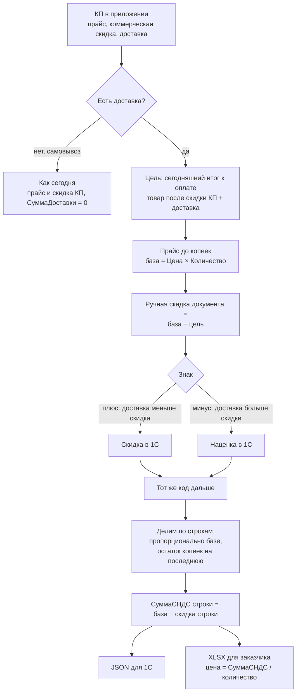
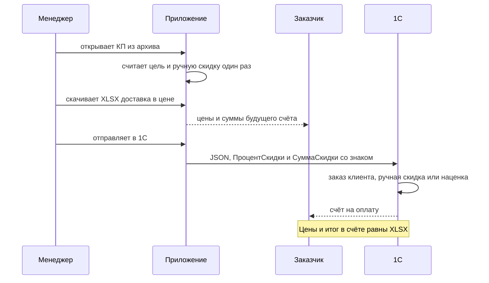

# Доставка в JSON для 1С и в XLSX «доставка в цене»

## Problem Statement

Как сделать так, чтобы менеджер до отправки в 1С отдал заказчику файл с теми же ценами, что потом окажутся в счёте, и чтобы 1С получила заказ с доставкой без ручной правки скидки и копеек.

## Что проверено в 1С

Две загрузки, обе прошли без расхождений до копейки.

| Заказ | Коммерческая скидка в КП | Знак ручной скидки в 1С | Итог документа | Счёт |
|---|---:|---|---:|---|
| 211 (файл 214) | 25 % | плюс, **скидка** 379 303,55 (17,33 %) | 1 809 912,75 | № 478 |
| 211 с пятью процентами (`new_211_markup_5.json`) | 5 % | минус, **наценка** −58 539,85 (−2,67 %) | 2 247 756,15 | № 481 |

1С-ник подтвердил: в КА скидка и наценка — одна сущность. Плюс уменьшает сумму, минус увеличивает. Отдельного флажка в JSON не нужно. В обоих случаях 1С берёт сумму ручной скидки, а процент только показывает.

## Как это работает

Один и тот же расчёт идёт для скидки и для наценки. Разница только в знаке результата.



## Как деньги раскладываются

На примере 211 с пятью процентами. Доставка 168 000 ₽ больше скидки 109 460,85 ₽, поэтому ручная скидка уходит в минус.

```
Прайс по карточке                     2 189 217,00
− коммерческая скидка 5 %               −109 460,85
+ доставка                              +168 000,00
= итог к оплате (цель)                 2 247 756,15      не меняется

Прайс, округлённый до копеек          2 189 216,30      база для 1С
− ручная скидка                          −58 539,85      знак минус = наценка
= итог к оплате                        2 247 756,15      тот же
```

Расхождение −58 539,85 и 58 539,15 (168 000 − 109 460,85) равно 0,70 ₽. Это разница прайса до и после округления до копеек.

При скидке 25 % всё то же, но ручная скидка получается положительной: 379 303,55.

## Кто что видит



## Что видит человек в итоге

Заказ 481 (`new_211_markup_5.json`), строка 1, С40.30-8, 200 шт.

| Где | Цена | Сумма |
|---|---:|---:|
| Карточка в приложении (скидка КП 5 %) | 8 501,82 | |
| JSON → заказ 1С | 8 949,28 | 1 837 716,92 |
| XLSX и счёт | 9 188,58 | 1 837 716,92 |

Колонка «Цена» в счёте не умножается на количество: 9 188,58 × 200 = 1 837 716,00, а строка 1 837 716,92. Колонка «Сумма» берётся числом.

## Recommended Direction

Одна чистая функция денег, два выхода. Её вызывают сборка JSON (`core/invoice_export.py`) при доставке и кнопка «XLSX (доставка в цене)». Самовывоз, обычные PDF/XLSX и карточка заказа эту функцию не вызывают.

Формула:

1. Цена строки округляется до копеек.
2. Итог документа не меняется: это сегодняшняя сумма к оплате, в ней уже сидит доставка.
3. Ручная скидка документа = сумма по округлённому прайсу − этот итог. Знак как получился: плюс — скидка, минус — наценка. На экран уходит процент до двух знаков, в файл — точная сумма.
4. Скидка делится по строкам пропорционально сумме строки, остаток копеек падает на последнюю.
5. Сумма строки = округлённая цена × количество − скидка строки. `СуммаДоставки` в сумму не прибавляется и остаётся отдельным полем.
6. НДС строки = сумма строки × 22/122.

В JSON `Цена` — округлённый прайс. В XLSX `Цена` — сумма строки / количество. Колонка «Сумма» — точная сумма строки, не произведение показанной цены на количество.

## Key Assumptions to Validate

- [x] Заказчик по XLSX заранее видит цену счёта, а не цену карточки
- [x] Успех: JSON с доставкой сходится с принятым заказом, XLSX строка в строку сходится со счётом
- [x] Самовывоз не меняется
- [x] Обычные PDF/XLSX и карточка заказа не меняются
- [x] 1С не прибавляет `СуммаДоставки` к сумме строки. Проверено на заказах 478 и 481
- [x] 1С берёт `СуммаСкидки`, а не пересчитывает её из процента. На заказе 481 процент дал бы −58 452,08, в подвале −58 539,85
- [x] Минус в `ПроцентСкидки` и `СуммаСкидки` — это наценка, отдельного флажка нет. Проверено заказом 481
- [ ] Остаток копеек на последней строке 1С принимает и на других количествах, не только на 200 и 30
- [ ] Ограничения ручной наценки (максимальный процент в соглашении или правах пользователя) в проде не мешают. В тесте в окне стояло 0,00 и наценку 1С приняла

## MVP Scope

- Чистая функция и два теста-эталона: 211 со скидкой 25 % (плюс) и 211 со скидкой 5 % (минус).
- JSON с доставкой строится этой функцией при любом знаке. Самовывоз идёт старым путём.
- Кнопка «XLSX (доставка в цене)» печатает те же суммы и цены счёта. НДС «в том числе» считается как × 22/122.

## Not Doing (and Why)

- Самовывоз. Там доставки нет, и этот пересчёт скидки не нужен.
- Обычные PDF/XLSX и цены в карточке. Заказчик сравнивает со счётом отдельный файл.
- Запись выведенного процента (17,33 или −2,67) в коммерческое предложение. Это представление для 1С, коммерческая скидка остаётся 25 % или 5 %.
- Отдельный флажок «наценка» в JSON. Знак минус работает и так.
- Отдельная номенклатура «доставка» в JSON. В счетах 478 и 481 такой строки нет.
- Два котла (плиты и сваи порознь) внутри цены этого файла. В 1С одна ручная скидка на документ, счёт делит её по сумме строк.

## Open Questions

Нет. Ещё одна загрузка в 1С на заказе с другим числом строк подтвердит остаток копеек, но формулу не меняет.
