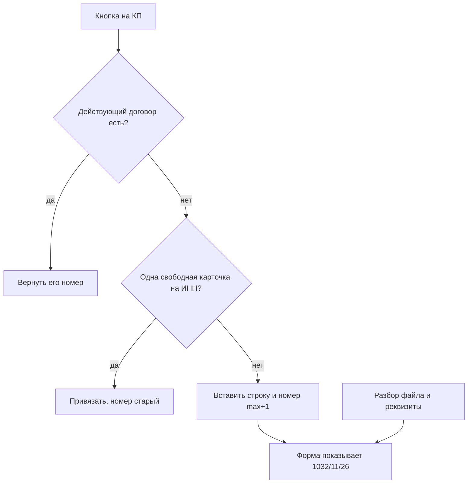
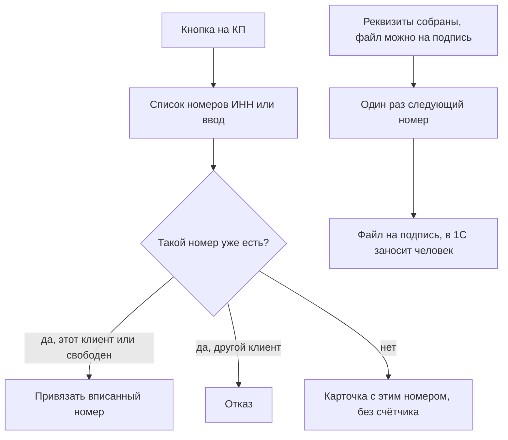

# Номер договора в момент готового файла

**Статус**: IDEATE ✅ · SPECIFY ✅ · PLAN
**Дата**: 2026-11-02
**Спека:** [../specs/nomer-dogovora-pri-gotovom-fajle.md](../specs/nomer-dogovora-pri-gotovom-fajle.md)
**План:** [../develop/plans/2026-11-02-nomer-dogovora-pri-gotovom-fajle.md](../develop/plans/2026-11-02-nomer-dogovora-pri-gotovom-fajle.md)
**Продолжает:** [spravochnik-kontragentov-s-dogovorom.md](spravochnik-kontragentov-s-dogovorom.md), [reestr-dogovorov-na-kontragentov-1c.md](reestr-dogovorov-na-kontragentov-1c.md)

## Problem Statement

Как выдавать следующий номер только договору, который уже можно отдать на подпись, и при этом оставлять старым номерам из Excel и 1С их собственные номера?

## Recommended Direction

Живой договор по-прежнему подписывают электронной подписью, а в 1С номер заносит человек. Меняется только момент, когда программа считает следующий номер.

Старый клиент. На КП нет привязанного договора. Кнопка показывает номера этого ИНН, которые уже лежат в базе, и поле для номера из Excel или 1С. Выбранный или вписанный номер привязывается как есть. Если строки с таким номером нет, она создаётся с этим текстом, без реквизитов и без счётчика. Пустые реквизиты у старой карточки нормальны: бланк по ним в программе не собирают.

Новый контрагент. Номер появляется один раз, когда обязательные реквизиты заполнены и файл договора уже можно скачать на подпись. Месяц и год берутся из даты этого договора. Повторное сохранение реквизитов номер не двигает.

Перед этим на локальной `plita.db` удаляется одна строка, которую кнопка завела сама: `1032/11/26`, ООО ТД «УНИСТРОЙ МАРКЕТ», клиент `4415`, `2026-11-02T17:14:48`. Остальные 383 строки — три загрузки реестра и 1С, их не трогают. После удаления потолок числового префикса — `1031/10/26` («Вертикаль»). Сверка с Excel проверяет, что в файле юриста нет номера выше. Дальше Excel новые номера не выдаёт.

## Как работает сейчас

Кнопка «в реестре договора нет» на карточке КП вызывает `POST /api/v1/commercial/archive/directory/{counterparty_id}/contract`. Для КП №19 это был клиент `4415`.

`_keep_link_or_create` смотрит этого клиента:

1. Неотменённый договор уже есть. Возвращается его номер, новая строка не создаётся.
2. На ИНН ровно одна свободная неотменённая карточка, ровно один активный клиент и у него ещё нет действующего договора. Карточка привязывается, номер остаётся прежний.
3. Иначе в той же транзакции вставляется строка `supply_contract`. Номер считается до вставки: из всех номеров, включая отменённые, берётся наибольшее число до первого слэша и к нему прибавляется единица. Месяц и две цифры года берутся из календарной даты сервера. Нажатие 2 ноября 2026 при потолке `1031` дало `1032/11/26`. Статус строки — «нет». Реквизиты пустые.

Статус «нет» всё равно действующий: отсекается только «отмена не будем работать». Пустая строка снимает блокировку «Нет действующего договора поставки», занимает единственное место договора клиента и попадает в шапку счёта. Word и PDF при этом собрать нельзя.

Разбор файла возвращает поля бланка без номера. «Сохранить реквизиты» обновляет колонки бланка и номер не включает. Форма показывает уже записанное поле `number`.

В локальной базе на 2 ноября 2026:

| Когда появилось | Строк | Откуда |
|---|---|---|
| 27 октября, 23:34 | 217 | реестр, лист без сомнений |
| 29 октября, 16:31 | 6 | ещё номера реестра |
| 30 октября, 15:32 | 160 | старые договоры 1С, 2019–2024 |
| 2 ноября, 17:14 | 1 | кнопка, `1032/11/26` |

Событие `status` есть только у строки `1032`. У остальных 383 событий — привязка `counterparty_id`. Заполненного полного имени нет ни у одной строки.

## Как будет работать

Кнопка больше не вызывает выдачу номера.

Старый клиент. На экране номера этого ИНН и поле ввода. Человек выбирает строку или вписывает номер из Excel или 1С. Номер найден и свободен — привязывается. Номер найден у другого клиента — отказ. Номера в базе нет — создаётся карточка с вписанным текстом, датой из номера, статусом «нет» и пустыми реквизитами. Счётчик `max+1` не участвует. Счёт ставит этот номер в шапку, как и сейчас для загруженных карточек.

Новый контрагент. Реквизиты собираются в программе. Пока бланк не готов, номера нет и счёт этого клиента не штампуется пустышкой. В момент, когда файл можно отдать на подпись, программа один раз берёт следующий числовой префикс и дату договора. Файл уходит на электронную подпись тем же путём, что и сейчас: человек подписывает и заносит номер в 1С. Отправки оператору ЭДО программа не делает.

Повторная сборка файла тот же номер не меняет. Отмена номер не освобождает.

Локальная подготовка, не код продукта: удалить строку `1032/11/26` и её событие, клиента `4415` оставить. Сверить потолок базы с Excel. Если в файле нет номера выше `1031`, следующий договор программы получит `1032`. Пачки 27, 29 и 30 октября не удаляются.

## Key Assumptions to Validate

- [ ] В Excel юриста нет числового префикса выше `1031`. Проверка: сверка файла с локальной базой до удаления `1032` и сразу после.
- [ ] После сверки юрист новые номера в Excel не выдаёт. Проверка: следующий реальный договор появляется только из программы.
- [ ] Для счёта старому клиенту достаточно привязанного номера с пустыми реквизитами. Проверка: выбранный номер из реестра снимает «Нет действующего договора поставки» и не требует бланка.
- [ ] Новый номер нужен только когда бланк уже можно скачать. Проверка: до заполнения реквизитов у нового клиента строки со следующим номером нет.

## MVP Scope

- Кнопка на КП не вызывает `_allocate_number`. Она даёт выбрать карточку этого ИНН или вписать номер.
- Вписанный новый номер сохраняется буквально. Дата берётся из номера, реквизиты остаются пустыми.
- Следующий номер считается один раз при готовности файла нового договора.
- На локальной базе удаляется только `1032/11/26`. Потолок сверяется с Excel.

## Not Doing (and Why)

- Удаление 217, 6 и 160 загруженных строк — это реестр и 1С, не тестовые договоры.
- Удаление клиента `4415` — убирается только пустая строка договора.
- Дозаполнение реквизитов старых карточек — бланк по ним в программе не собирают.
- Отправка оператору ЭДО и запись договора в 1С — подпись и 1С остаются у человека.
- Два диапазона номеров — после сверки источник один, дырка в нумерации не нужна.
- Автовыбор среди нескольких номеров одного ИНН — человек выбирает сам.

## Open Questions

Нет. Номер старого договора берётся из базы или вписывается. Номер нового появляется вместе с файлом на подпись.
