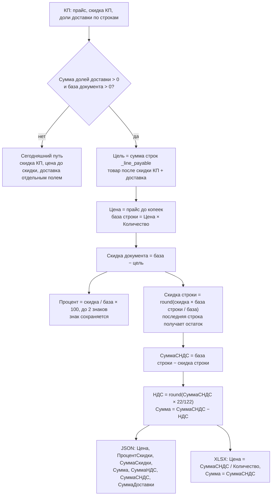
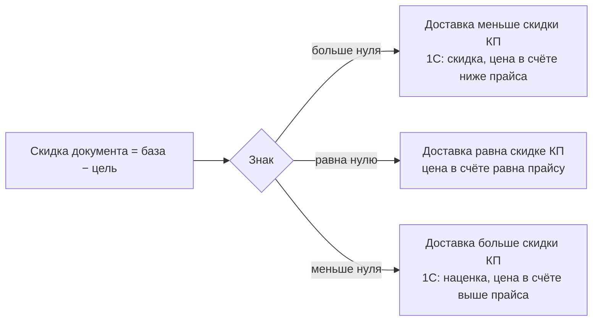
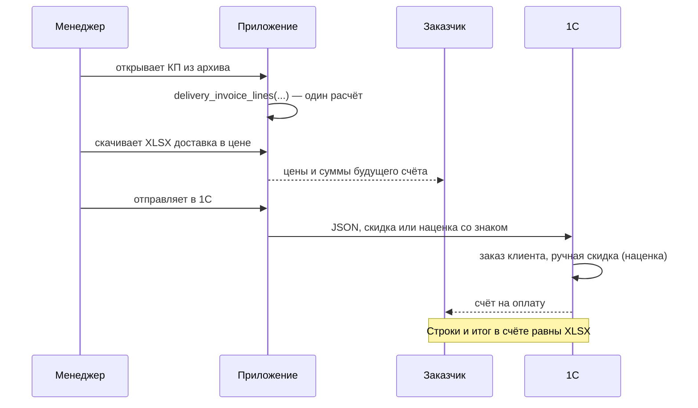

# Spec: Доставка в JSON для 1С и в XLSX «доставка в цене»

> **Источник идеи:** [`ai_docs/ideas/1c-delivery-invoice-parity.md`](../ideas/1c-delivery-invoice-parity.md)
> **План:** [`ai_docs/develop/plans/2026-11-11-1c-delivery-invoice-parity.md`](../develop/plans/2026-11-11-1c-delivery-invoice-parity.md)
> **Фаза SDD:** SPECIFY ✅ → PLAN ✅ → IMPLEMENT
> **Дата:** 2026-11-11
> **Связанные модули:** `core/invoice_export.py`, `core/commercial_offer_xlsx.py`, `core/embed_delivery_in_unit_price.py`, `core/commercial_pricing.py`
> **Меняет при доставке:** [`invoice-warehouse-and-delivery.md`](invoice-warehouse-and-delivery.md) (деньги строки) и [`kp-xlsx-delivery-in-unit-price.md`](kp-xlsx-delivery-in-unit-price.md) (D4, D5, D8, D10). Самовывоз и обычные PDF/XLSX те спеки не трогают.  
> **С 2026-11-13:** числа этой спеки не меняются. Файл, который менеджер отдаёт заказчику, — PDF, не XLSX: [`kp-pdf-delivery-in-unit-price.md`](kp-pdf-delivery-in-unit-price.md). Где ниже написано «цена в XLSX» и «колонка Сумма», для заказчика это колонки того PDF.

---

## Assumptions I'm Making

1. Коммерческое предложение создаётся у нас. JSON уходит в 1С, там из него делают заказ клиента и счёт. XLSX «доставка в цене» заказчик смотрит до отправки, чтобы увидеть цены будущего счёта.
2. Эталоны денег — два заказа, оба загружены в 1С без расхождения копеек:
   - 211, скидка КП 25 %, доставка меньше скидки: итог 1 809 912,75, НДС 326 377,71, счёт № 478.
   - 211, скидка КП 5 %, доставка больше скидки: итог 2 247 756,15, НДС 405 333,08, счёт № 481.
3. Итог к оплате не меняется. Это сегодняшняя сумма строк: товар после коммерческой скидки плюс доля доставки. Новая формула только по-другому раскладывает те же деньги.
4. 1С не прибавляет `СуммаДоставки` к сумме строки. Проверено на 478 и 481. Поле в JSON остаётся.
5. 1С берёт `СуммаСкидки`, а не пересчитывает её из процента. На 481 пересчёт из −2,67 % дал бы −58 452,08, в подвале стоит −58 539,85.
6. **Скидка и наценка в 1С — одно значение со знаком.** Плюс — скидка, минус — наценка. Подтверждено 1С-ником и заказом 481. Отдельного поля или флажка в JSON нет.
7. Коммерческая скидка в базе не меняется. Выведенный процент (17,33 или −2,67) существует только в JSON и не записывается в КП.
8. Остаток копеек на последней строке 1С приняла на количествах 200 и 30. На других количествах то же правило, отдельной подстройки нет.
9. Ограничения ручной скидки и наценки (максимальный процент в соглашении или правах пользователя) в тесте не мешали. В проде они могут быть включены. Это настройки 1С, наш JSON их не обходит.

→ Если что-то из этого неверно — править spec до плана.

---

## Decisions locked

| # | Тема | Решение |
|---|------|---------|
| D1 | Когда новая формула | Сумма долей доставки больше нуля и база документа больше нуля. Знак скидки не важен. Самовывоз идёт сегодняшним кодом |
| D2 | Одна функция | JSON и XLSX «доставка в цене» вызывают одну чистую функцию. Второй формулы для кнопки нет |
| D3 | Цена в JSON | Округлённый прайс до скидки: 8 949,28 и 13 312,01. Это цена заказа 1С, не цена счёта |
| D4 | Цена в XLSX | Сумма строки / количество, до копеек. Это цена счёта |
| D5 | Сумма строки | Округлённый прайс × количество − скидка строки. Доставка в сумму не прибавляется. При минусовой скидке сумма растёт |
| D6 | Процент | Один на шапку и на все строки, до двух знаков, со знаком скидки. Деньги — точная сумма скидки, не «процент от прайса» |
| D7 | Делёж скидки | Пропорционально сумме строки по округлённому прайсу. Остаток копеек — на последнюю строку с количеством больше нуля. Знак не меняет правило |
| D8 | Котлы | `СуммаДоставки` по-прежнему доля своего котла. На цену строки котлы не влияют: скидка одна на документ |
| D9 | НДС | По строке `round(сумма × 22/122, 2)`, шапка — сумма строк. В этом XLSX порог старых КП (`× 0,22` для id меньше 27) не используется |
| D10 | Колонка «Сумма» в XLSX | Число суммы строки, не формула «количество × цена». 9 188,58 × 200 = 1 837 716,00, а строка счёта 1 837 716,92 |
| D11 | Строки доставки и сноска | В этом XLSX нет строки доставки и нет прежней сноски «скидка на доставку не распространяется». Таблица и итоги совпадают со счётом |
| D12 | База | `discount_percent`, `unit_price` и хеш снимка не меняются |
| D13 | Скидка и наценка | Одно значение со знаком. В `ПроцентСкидки` и `СуммаСкидки` минус означает наценку. Нового поля нет |
| D14 | Отрицательная скидка в коде | Не отдельная ветка и не флажок. Вычитание в D5 само даёт рост суммы |

---

## Objective

Менеджер отправляет в 1С заказ с доставкой, который грузится без ручной правки скидки и без правки копеек. До отправки он скачивает XLSX, и заказчик видит в нём те же цены, суммы, итог и НДС, что потом будут в счёте.

Самовывоз, обычный PDF, обычный XLSX и карточка заказа остаются как сейчас. В карточке цена с учётом только коммерческой скидки, в счёте и в этом XLSX — цена, в которую уже вошла доставка.

### Пользователь

Менеджер в карточке архива. Заказчик читает XLSX. 1С читает JSON.

### Сценарии

1. **Доставка меньше скидки.** Ручная скидка в 1С положительная. Эталон 1 ниже.
2. **Доставка больше скидки.** Ручная скидка отрицательная, 1С показывает наценку. Эталон 2 ниже.
3. **Самовывоз.** JSON и файлы как сегодня: прайс без нового округления, коммерческий процент, `СуммаДоставки` = 0.
4. **Обычный XLSX и PDF.** Строка доставки на месте, НДС как сейчас.
5. **Карточка и база.** Цены и коммерческая скидка не переписываются. Повторный обычный файл не меняется.

---

## Как это работает

### Алгоритм



### Знак скидки



### Деньги на эталоне 2 (скидка КП 5 %)

```
Прайс по карточке (неокруглённый)    2 189 217,00
− скидка КП 5 %                        −109 460,85
+ доставка                             +168 000,00
= цель, итог к оплате                 2 247 756,15      не меняется

Прайс, округлённый до копеек          2 189 216,30      база для 1С
− ручная скидка (минус = наценка)       −58 539,85
= итог к оплате                       2 247 756,15      та же цель
```

Расхождение между −58 539,85 и 58 539,15 (168 000 − 109 460,85) равно 0,70 ₽. Это разница прайса до и после округления до копеек.

### Путь данных



### Откуда берётся каждое число в строке 1 эталона 2

| Поле | Как считается | Значение |
|---|---|---:|
| `Цена` | прайс до копеек | 8 949,28 |
| База | 8 949,28 × 200 | 1 789 856,00 |
| `СуммаСкидки` | round(−58 539,85 × 1 789 856,00 / 2 189 216,30) | −47 860,92 |
| `СуммаСНДС` | 1 789 856,00 − (−47 860,92) | 1 837 716,92 |
| `СуммаНДС` | round(1 837 716,92 × 22/122) | 331 391,58 |
| `Сумма` | 1 837 716,92 − 331 391,58 | 1 506 325,34 |
| Цена в XLSX и в счёте | round(1 837 716,92 / 200, 2) | 9 188,58 |

---

## Эталон 1: скидка КП 25 %

Прайс до округления: 8 949,283209360001 и 13 312,012003200003. Количества 200 и 30. Доставка 146 087,10 и 21 912,90. Цель 1 809 912,75.

| | С40.30-8 | С60.30-8 | Документ |
|---|---:|---:|---:|
| `Цена` в JSON | 8 949,28 | 13 312,01 | |
| База | 1 789 856,00 | 399 360,30 | 2 189 216,30 |
| `ПроцентСкидки` | 17,33 | 17,33 | 17,33 |
| `СуммаСкидки` | 310 110,40 | 69 193,15 | 379 303,55 |
| `СуммаСНДС` | 1 479 745,60 | 330 167,15 | 1 809 912,75 |
| `СуммаНДС` | 266 839,37 | 59 538,34 | 326 377,71 |
| `Сумма` | 1 212 906,23 | 270 628,81 | |
| `СуммаДоставки` | 146 087,10 | 21 912,90 | |
| Цена в XLSX и в счёте | 7 398,73 | 11 005,57 | |

Проверка: 379 303,55 / 2 189 216,30 = 17,325996… % → 17,33.

## Эталон 2: скидка КП 5 %

Те же прайс, количества и доставка. Цель 2 247 756,15. Файл: `data/exchange_export/new_211_markup_5.json`. Загружен в 1С как заказ 481.

| | С40.30-8 | С60.30-8 | Документ |
|---|---:|---:|---:|
| `Цена` в JSON | 8 949,28 | 13 312,01 | |
| База | 1 789 856,00 | 399 360,30 | 2 189 216,30 |
| `ПроцентСкидки` | −2,67 | −2,67 | −2,67 |
| `СуммаСкидки` | −47 860,92 | −10 678,93 | −58 539,85 |
| `СуммаСНДС` | 1 837 716,92 | 410 039,23 | 2 247 756,15 |
| `СуммаНДС` | 331 391,58 | 73 941,50 | 405 333,08 |
| `Сумма` | 1 506 325,34 | 336 097,73 | |
| `СуммаДоставки` | 146 087,10 | 21 912,90 | |
| Цена в XLSX и в счёте | 9 188,58 | 13 667,97 | |

Проверка: −58 539,85 / 2 189 216,30 = −2,674009… % → −2,67. Эти же числа показала 1С в заказе и счёте.

---

## Формула

Считать в `Decimal`, квант копейки, `ROUND_HALF_UP`.

Цель — сегодняшняя сумма строки из `_line_payable`: неокруглённый прайс × (1 − коммерческая скидка / 100) × количество + доля доставки, затем квант копейки. Итог документа — сумма этих строк.

Если сумма долей доставки больше нуля:

1. `Цена` = прайс до копеек.
2. База строки = `Цена` × количество. База документа — сумма баз строк с количеством больше нуля. Если она равна нулю, новую формулу не применять.
3. Скидка документа = база документа − цель. Знак сохраняется.
4. Процент = скидка документа / база документа × 100, до двух знаков, со знаком. Один и тот же в шапке и в каждой строке.
5. Скидка каждой строки, кроме последней с количеством больше нуля: round(скидка документа × база строки / база документа). Последняя получает остаток.
6. `СуммаСНДС` = база строки − скидка строки.
7. `СуммаНДС` = round(`СуммаСНДС` × 22/122). `Сумма` = `СуммаСНДС` − `СуммаНДС`.
8. `СуммаДоставки` — прежняя доля котла, в пункты 6–7 не входит.
9. Шапка `СуммаСкидки`, `СуммаНДС`, `СуммаДокумента` — суммы строк.

Цена XLSX = round(`СуммаСНДС` / количество, 2). Колонка «Сумма» = `СуммаСНДС`.

---

## Tech Stack

Python 3, `Decimal`, FastAPI. Новых зависимостей нет. Фронтенд и схема SQLite не меняются.

---

## Commands

```bash
source venv/bin/activate
pytest tests/test_delivery_invoice_parity.py tests/test_archive_invoice_export.py tests/test_embed_delivery_in_unit_price.py tests/test_commercial_offer_xlsx.py tests/test_archive_endpoints.py -q
```

---

## Project Structure

```
ai_docs/ideas/1c-delivery-invoice-parity.md
ai_docs/specs/1c-delivery-invoice-parity.md
core/delivery_invoice_parity.py          # NEW: чистые деньги, без Excel и без базы
tests/test_delivery_invoice_parity.py    # NEW: два эталона и крайние случаи
core/invoice_export.py                   # при доставке берёт функцию
core/commercial_offer_xlsx.py            # флаг embed вызывает ту же функцию
tests/test_archive_invoice_export.py     # кейс со скидкой 10 % и доставкой пересчитать
tests/test_embed_delivery_in_unit_price.py
tests/test_commercial_offer_xlsx.py
data/exchange_export/new_211_markup_5.json   # эталон 2, не менять
```

`embed_delivery_in_unit_prices` кнопка больше не вызывает. `allocate_line_delivery_kopecks` остаётся: из него берётся `СуммаДоставки` и доля в сегодняшней сумме строки.

---

## Code Style

Функция без ввода-вывода. Оба вызывающих получают один результат.

```python
from dataclasses import dataclass
from decimal import Decimal


@dataclass(frozen=True)
class ParityLine:
    price: Decimal               # округлённый прайс, поле «Цена» в JSON
    discount_percent: Decimal    # со знаком: минус — наценка
    discount_amount: Decimal     # со знаком
    net: Decimal
    vat: Decimal
    payable: Decimal             # СуммаСНДС
    invoice_unit_price: Decimal  # цена колонки XLSX и счёта


def delivery_invoice_lines(
    *,
    prices: list[Decimal],
    qty: list[int],
    target_payable: list[Decimal],
    delivery_rub: list[Decimal],
) -> list[ParityLine] | None:
    """Строки варианта А. Скидка может быть отрицательной.

    None — база документа равна нулю, вызвать сегодняшнюю формулу.
    """
```

`invoice_export._goods_and_totals` при `None` оставляет сегодняшний `_line_payable` и коммерческий процент. При списке подставляет `ParityLine`, а `СуммаДоставки` копирует из `delivery_rub`. `target_payable` — это значения `_line_payable`, которые сегодня уже считаются.

---

## Testing Strategy

| Уровень | Что |
|---|---|
| Чистая функция | Эталон 1 и эталон 2 сходятся по таблицам выше, включая знак процента и сумм. Одна строка забирает всю скидку. Строка с количеством 0 не делит базу и не становится последней. База документа равна нулю возвращает `None`. Скидка ровно ноль даёт цену счёта равную прайсу |
| JSON | Доставка и скидка 10 % дают новый процент и сумму строки без прибавления доставки. Итог документа равен сегодняшнему. На эталоне 2 в `ПроцентСкидки` и `СуммаСкидки` минус. Самовывоз не меняется. Хеш снимка не зависит от выведенного процента |
| XLSX | С флагом нет строки доставки и нет старой сноски. «Сумма» равна `СуммаСНДС`, «Цена» равна цене счёта, НДС равен сумме строчных 22/122. На эталоне 2 цены выше цен карточки. Без флага строка доставки на месте |

Регрессия: `tests/test_archive_invoice_export.py` для самовывоза, `tests/test_archive_endpoints.py` для имени файла и выключенной кнопки при доставке 0.

---

## Boundaries

**Always:**

- Считать цель сегодняшним `_line_payable`, не вторым способом.
- Писать XLSX из того же результата, что и JSON.
- Оставлять коммерческую скидку и прайс в базе.
- Отправлять наценку знаком минус в тех же полях, что и скидку.

**Ask first:**

- Менять самовывоз, обычный PDF/XLSX, карточку.
- Убирать `СуммаДоставки` из JSON.
- Добавлять в JSON отдельное поле наценки или флажок.

**Never:**

- Записывать выведенный процент в `KP_offers`.
- Считать цену XLSX как прайс после скидки КП плюс доставка на штуку.
- Делить доставку на цену двумя котлами в этом файле.
- Подгонять процент так, чтобы процент × прайс заменил точную сумму скидки.

---

## Success Criteria

1. На числах эталона 1 JSON совпадает с таблицей: итог 1 809 912,75, скидка 379 303,55, НДС 326 377,71.
2. На числах эталона 2 JSON совпадает с `new_211_markup_5.json` по каждому полю: −2,67 %, −58 539,85, итог 2 247 756,15, НДС 405 333,08.
3. XLSX «доставка в цене» на эталоне 1 даёт цены 7 398,73 и 11 005,57, на эталоне 2 — 9 188,58 и 13 667,97. Суммы строк и итог равны счетам 478 и 481. Строки доставки нет.
4. Самовывоз собирается сегодняшним кодом.
5. Обычный XLSX по-прежнему содержит строку доставки.
6. Повторное чтение КП из базы показывает прежние `unit_price` и `discount_percent`.
7. Команды из Commands проходят.

---

## Open Questions

Нет.
